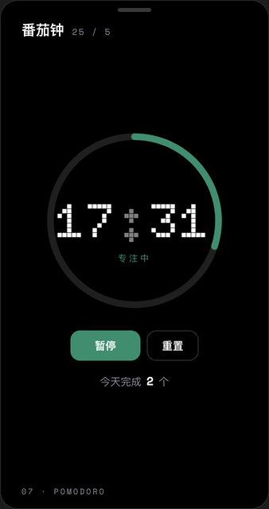
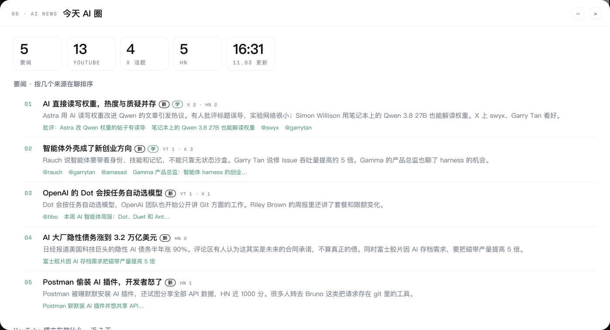

# obsidian-ai-dashboard

我在 Obsidian 里用的个人看板。打开一个笔记，就能看到今天要做什么、这周的进度，还有一张每天自动更新的「今天 AI 圈」资讯卡。


<sub>截图里的待办、计划、灵感都是演示数据（`demo/make-demo.mjs` 生成）；资讯卡是真实的当天内容。</sub>

> 这是我自己的版本，按我的 vault 结构写的，放出来给大家参考。可以拿去改，但我不保证能在你的电脑上直接跑起来，也没法逐个答疑。

## 先看效果：生成一个演示 vault

不想先整理自己的笔记，可以生成一个装满虚构内容的演示 vault，直接看效果：

```sh
node demo/make-demo.mjs
```

它会在仓库里生成 `demo-vault/` 文件夹，在 Obsidian 里选「打开本地仓库」打开它（需要装 Dataview，见下面的安装第 0 步），再打开根目录的「看板」。日期按运行当天生成；隔天想让日期对上，加 `--refresh` 再跑一次。演示 vault 里的资讯卡只显示、不更新，不会用演示内容覆盖你自己的资讯数据。

**这个脚本不删除任何文件**，也不碰你自己的笔记：它只往自己生成的文件夹里写，刷新时只覆盖它上次写的、之后没被改过的文件。演示库就是演示用的，请不要在里面写真实笔记。如果仓库放在某个 vault 里面（比如已经按下面的步骤装成了 `_dashboard`），它会拒绝在那里生成，请用 `--out=` 指定一个 vault 外面的空文件夹，比如 `node demo/make-demo.mjs --out=$HOME/ai-dashboard-demo`。

## 有哪些卡

| 卡片 | 读的是哪里 |
|---|---|
| 今天 | `daily/` 里当天的日记，可以直接在卡上加待办、打勾 |
| 小红书 | 创作文件夹里各个项目的进度，以及灵感文件里标了「下一期」的句子 |
| AI 学习路线 | 一份按「第 N 周 · 标题」分段的学习计划，显示当前在第几站、总进度 |
| 本周要完成 | 学习计划里当前这一块没勾的条目，加上 `weekly/` 里自己加的 |
| 灵感收件箱 | 灵感文件末尾的几段，可以在卡上记一笔 |
| 今天 AI 圈 | 每天 8:30 自动整理的 AI 资讯（下面细说） |
| 番茄钟 | 25 分钟专注 / 5 分钟休息，到点系统通知 |



所有卡的内容都是打开看板时从你的笔记里现读的，代码里不存任何个人内容。

## 你的笔记要怎么写

看板不自带内容，只认下面这些格式。路径都能在 `config.json` 里改成你自己的；格式不对的卡会显示空状态（比如「今天还没定」），不会报错。演示库里的笔记就是现成的样例，照着写最快。

| 卡片 | `config.json` 里的设置（缺省值） | 看板认的格式 |
|---|---|---|
| 今天 | `dailyDir`（`daily`） | 文件名是日期，如 `2026-11-03.md`；里面有 `## 今日` 标题，下面是 `- [ ]` 待办 |
| 本周要完成 | `weeklyDir`（`weekly`） | 文件名是这周一的日期；里面有 `## 本周要完成` 标题，下面是 `- [ ]` 待办 |
| AI 学习路线 | `planPath`（`learning/plan.md`） | 用 `## 第 N 周 · 标题` 分站（最后一站可以写 `## 第 N 周起 · 标题`），每站下面是 `- [ ]` 条目；第一个还有没勾条目的站就是「当前站」 |
| 小红书 | `xhsDir`（`xiaohongshu`） | 每个项目一个子文件夹；子文件夹里的 `README.md` 开头写 `status: 进行中` 这样的属性，状态里不含「完成」「归档」「done」这类字样的算进行中；最近 30 天改过的项目（最多 3 个）显示成下面的标签 |
| 灵感收件箱 | `todoPath`（`To-do & inspiration.md`） | 空行分段，一段一条灵感；段落第一行可以是日期（`10.28` 或 `2026-10-30 · 内容`）；含「下一期」三个字的行显示在小红书卡的「打算做」 |
| 按模板新建 | `dailyTemplate` / `weeklyTemplate`（`templates/daily.md`、`templates/weekly.md`） | 今天或本周的文件还没建时，卡上的「新建」按钮用它当模板 |

一个最小的日记文件长这样：

```markdown
## 今日

- [ ] 读完一篇讲 RAG 的长文
- [ ] 剪下一期视频的开头
```

## 「今天 AI 圈」怎么来的

```
每天 8:30（macOS launchd 定时任务）
  → node news/fetch.mjs
     ① 抓：9 个 YouTube AI 博主的频道页、follow-builders 整理的 X 和播客数据、Hacker News 首页的 AI 帖子和热门评论
     ② 只把新内容交给 Claude Code（claude -p）总结，已经总结过的直接沿用
     ③ 写到 ~/.secondbrain-news/today.json
  → 看板打开时读这个文件画卡，看板本身不联网
```

卡上分四块：

- **要闻**：把几个来源讲同一件事的内容合并成一条，按「几个来源在聊」排序，挑 3–5 件。
- **YouTube 博主在做什么**：每条视频一句话讲了什么，播放量明显高于该频道平时的标「爆」。
- **X 上大家在聊什么**：按话题归纳，附原推链接。
- **Hacker News 工程师圈**：这是什么、工程师角度的要点、评论区在争什么。



标签含义：`新` 是 30 天内第一次出现的话题，`✦ 选题` 是能做成视频的，`学` 是值得作为工程师去学的。「选题」「学」按 `news/persona.md` 里写的读者背景判断。

### 不会越堆越多的本地数据

这是我最在意的一点，所以单独说：

- 数据只写在 vault 外的 `~/.secondbrain-news/`，每天覆盖。代码里给每个字段和条目数都设了上限，整个文件夹封顶 200KB（实际约 20KB），超了会自动删最旧的。
- 原始网页、评论都只在内存里处理，不落盘。
- 调用 Claude 时加了 `--no-session-persistence`（不存对话记录）和 `--strict-mcp-config`（不连其它连接器，否则每次会多留两份日志）。
- YouTube 缩略图下载到内存里显示，不进 Obsidian 的网页缓存。
- 运行日志只留最后 200 行；定时任务的输出直接丢弃。

我在自己电脑上完整跑过一次，扫描了运行期间整个用户目录新增的文件，确认没有会累积的东西。

## 安装

0. 需要：macOS（node 装在 `/opt/homebrew/bin` 或 `/usr/local/bin`）、Obsidian + [Dataview](https://github.com/blacksmithgu/obsidian-dataview) 插件（设置里打开 *Enable JavaScript queries*）。资讯卡另外需要 Node 18 以上，以及已登录的 [Claude Code](https://code.claude.com/docs/en/overview)。

1. 把这个仓库放进你的 vault，文件夹名必须叫 `_dashboard`：
   ```sh
   cd /path/to/your-vault
   git clone https://github.com/ziyu-llm/obsidian-ai-dashboard.git _dashboard
   ```
2. 复制一份设置，改成你 vault 里的真实路径：
   ```sh
   cp _dashboard/config.example.json _dashboard/config.json
   ```
3. 把 `_dashboard/examples/看板.md` 复制到 vault 根目录，在 Obsidian 里打开它就是看板。
4. （资讯卡）写你自己的读者介绍，Claude 会按它判断「选题」和「学」：
   ```sh
   cp _dashboard/news/persona.example.md _dashboard/news/persona.md
   ```
   先手动跑一次，确认能出结果：
   ```sh
   node _dashboard/news/fetch.mjs
   ```
5. （资讯卡）装每天 8:30 的定时任务：打开 `launchd/com.example.ai-dashboard-news.plist`，把 `__HOME__` 和 `__VAULT__` 换成你的路径，然后：
   ```sh
   cp _dashboard/launchd/com.example.ai-dashboard-news.plist ~/Library/LaunchAgents/
   launchctl bootstrap gui/$(id -u) ~/Library/LaunchAgents/com.example.ai-dashboard-news.plist
   ```

不装定时任务也行：看板打开时，如果数据不是今天的，而且已经过了 8:30，会自动在后台跑一次。卡片右上角的 ↻ 也能手动刷新。

`config.json` 和 `news/persona.md` 已经写进 `.gitignore`，不会被提交。

## 卸载

```sh
launchctl bootout gui/$(id -u)/com.example.ai-dashboard-news
rm ~/Library/LaunchAgents/com.example.ai-dashboard-news.plist
rm -r ~/.secondbrain-news
```

再删掉 vault 里的 `_dashboard` 文件夹和 `看板.md`。

## 致谢

- X 和播客数据来自 [follow-builders](https://github.com/zarazhangrui/follow-builders)
- Hacker News 数据来自 [HN Algolia API](https://hn.algolia.com/api)
- 字体 [Doto](https://github.com/oliverlalan/Doto) 和 [Space Mono](https://github.com/googlefonts/spacemono)，SIL Open Font License 1.1，授权文件在 `fonts/`

## License

代码按 [MIT](LICENSE) 授权。
