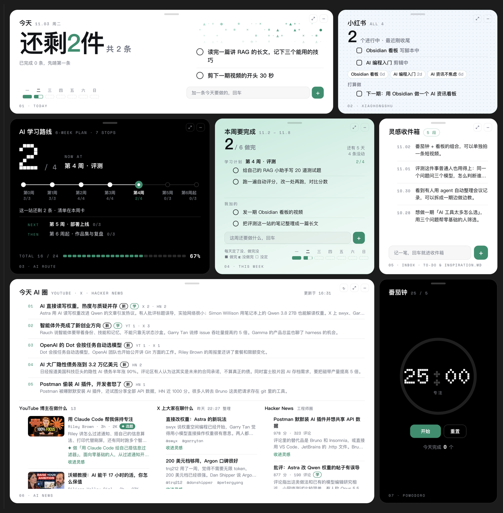

# dsh-obsidian-ai-task-dashboard

[ziyu-llm/obsidian-ai-dashboard](https://github.com/ziyu-llm/obsidian-ai-dashboard) 的 **dsh 版**。

原版用 macOS + Node + `claude -p` + launchd 刷新「今天 AI 圈」这张资讯卡。
这个版本把底座换成 [DeepSeek Harness](https://github.com/deepseek-ai)（下称 dsh）的
`headless` 一次性任务，全部跑在 Windows 上，去掉了 Node、Claude Code、launchd。

> **想用原版？** 去上游。**想换 agent 底座、或者用 Windows？** 看这个。



<sub>截图为上游原版界面，本版视觉结构相同，仅资讯刷新底座不同。</sub>

---

## 前提

| 需要 | 说明 |
|---|---|
| Obsidian + [Dataview](https://github.com/blacksmithgu/obsidian-dataview) | Dataview 设置里必须打开 **Enable JavaScript queries** |
| dsh 桌面应用 | **不是 npm 包**。装好后 `dsh --version` 有输出 |
| 一份模型凭据 | 任意 OpenAI 兼容网关都行，下文以 agens 为例 |

资讯卡之外的其他卡（今天 / 小红书 / 学习路线 / 本周 / 灵感 / 番茄钟）**不需要 dsh，也不需要密钥**，
只要 Obsidian + Dataview 就能显示。

---

## 快速开始

1. 装 Dataview，打开 JavaScript queries。
2. 把仓库里的 `view.js`、`view.css`、`debug.md`、`fonts/`、`news/` 拷进 vault 的 `_dashboard/`；
   把 `examples/` 里的 `看板.md`、`给 dsh 的信.md`、`与 dsh 对话.md` 拷到 vault 根目录。
3. 复制 `config.example.json` 为 `_dashboard/config.json`，按需改字段（见下）。
4. 在 Obsidian 里打开 `看板.md`。

### 关于 `config.json`

```json
{
  "dailyDir": "daily",
  "weeklyDir": "weekly",
  "planPath": "learning/plan.md",
  "xhsDir": "xiaohongshu",
  "todoPath": "To-do & inspiration.md",
  "dailyTemplate": "templates/daily.md",
  "weeklyTemplate": "templates/weekly.md",
  "news": true,
  "newsDir": "_dashboard/news-data"
}
```

| 字段 | 作用 |
|---|---|
| `base` | **可选**。当 `_dashboard/` 不在 vault 根目录时，填它相对 vault 的路径前缀（如 `"07-工作区/项目/demo-vault"`）。不填会自动尝试推导，推不出来就所有卡空白 |
| `newsDir` | 资讯数据目录。原版把数据写在 vault 外的 `~/.secondbrain-news`，本版改到 vault 内，这样共享文件就能驱动看板 |
| `news` | 设为 `false` 会关掉整张资讯卡和后台抓取 |
| 其余 | 各卡读的目录/文件路径，相对 `base` |

> **不要**加 `newsReadOnly`。原版用它给演示库上只读锁，本版已移除；加了会把 ↻ 挡死。

---

## 资讯卡怎么刷新

点「今天 AI 圈」卡片右上角的 ↻：

```
Obsidian ↻ → view.js runNews() → refresh.ps1 -Async → dsh headless（一次性任务）
  → 用 dsh 的 web_fetch 抓 HN / X / 播客 / YouTube
  → 让模型按 JSON Schema 总结成中文
  → 写回 vault 内的 news-data/today.json
  → view.js 的 fs.watch 检测到变化，自动重画
```

手动跑（同步，会等它跑完并输出结果）：

```powershell
powershell -NoProfile -ExecutionPolicy Bypass -File refresh.ps1 -Vault "C:\你的\vault" -Async
```

> **必须用 `-ExecutionPolicy Bypass`**，直接 `& refresh.ps1` 会被执行策略拦住。

### 需要先配好 dsh

1. 装 anysearch 插件（抓 YouTube 必需）：
   ```powershell
   dsh plugin --profile headless add @anysearch/anysearch-dsh
   ```
2. 在 `~/.dsh/profiles/headless/cordis.patch.yml` 里恢复三个被 headless 模板禁用的服务：
   ```yaml
   - id: credentials
     disabled: false
   - id: authorization
     disabled: false
   - id: deepseek-account
     disabled: false
   ```
   漏了会报 `configured web provider "anysearch" is not registered`，YouTube 抓不到。
3. 配 provider 与默认模型（`llm-pi-ai` + `agent-default-model`），**只写环境变量名不写密钥**。
4. 把密钥放进 `~/.dsh/.env`：`AGENS_API_KEY=你的密钥`。

完整步骤和排错表见 **[RESTORE.md](RESTORE.md)**。

---

## 双向：在 Obsidian 里给 dsh 留言

不需要插件、不需要端口。打开 `给 dsh 的信.md`，在「## 我说」下写一行：

```markdown
- 帮我看看今天还剩几件事
- 待办：把复盘写完
```

然后：

```powershell
# 1) 扫出还没回复的消息
powershell -NoProfile -ExecutionPolicy Bypass -File bridge.ps1 -Vault "C:\你的\vault" -Scan

# 2) 让 dsh 读 Scan 输出并作答，写成 reply.json（格式见下），再应用回写
powershell -NoProfile -ExecutionPolicy Bypass -File bridge.ps1 -Vault "C:\你的\vault" `
  -Apply -ReplyFile reply.json
```

`reply.json` 格式：

```json
[
  { "q": "与「我说」原文完全一致的问题",
    "a": "dsh 的回复",
    "todos": ["可选：加进今天日记的待办"] }
]
```

`与 dsh 对话.md` 会把回复整理成对话视图。`待办：` 开头的输入会变成看板「今天」卡的一条待办。

> 这是**轮询式**（你叫它才跑），不是秒级实时。要近实时得自己写 dsh Host 插件。

---

## 相对上游改了什么

| 文件 | 改动 |
|---|---|
| `view.js` | ① `NEWS_DIR()` 支持 `config.json` 的 `newsDir`，把资讯数据从 vault 外的 macOS 路径改到 vault 内；② 新增路径前缀机制 `BOARD_DIR` / `P()`，让 `_dashboard` 不在 vault 根时也能正确取数；③ `loadThumbs()` 跳过空 `data-thumb`；④ `runNews()` 从「spawn node 跑 fetch.mjs 再调 claude -p」改为「spawn refresh.ps1 → dsh headless」；⑤ 移除 `maybeAutoNews()` 的只读短路 |
| `refresh.ps1` | **新增**。↻ 的入口，把任务通过 stdin 交给 `dsh headless -`，并负责清理本次产生的会话 |
| `bridge.ps1` | **新增**。双向搬运（Scan / Apply） |
| `examples/给 dsh 的信.md`、`examples/与 dsh 对话.md` | **新增**。双向界面模板 |
| `config.example.json` | 加 `newsDir`；`base` 说明见上；移除 `newsReadOnly` |
| `LICENSE` | MIT，加一行本版版权 |
| 删除 | `launchd/`（macOS 定时任务）、`sync.sh`（macOS 复制脚本）、`demo/`（演示库生成器，与我们的 config 不兼容） |
| 保留原样 | `view.css`、`debug.md`、`fonts/`、`news/fetch.mjs`（仅作 SCHEMA 参考，不执行）、`news/persona.example.md`、`examples/看板.md`、`docs/` |

---

## 踩过的坑

这几条是这次适配真正花时间的地方，换台机器重新搭也会再遇到：

1. **`dsh headless` 每次调用必然新建一个会话**，官方没有 ephemeral / 不落盘模式。
   所以 `refresh.ps1` 在启动前记录 `~/.dsh/sessions` 快照，跑完由后台守护按差集删掉新增的。
2. **删除必须按快照差集，不能按目录名猜**。headless 的 cwd 变化会让会话落到不同工作区目录。
3. **`$psi.WorkingDirectory` 必须显式设置**，否则会话归属到错误工作区，GUI 里出现「未分组」。
4. **删了会话目录，投影缓存不会跟着删**。`~/.dsh/storages/session_projcache/sessions/<id>.json`
   会留成孤儿（每条约 7 KB），每次刷新加一条，永久累积。所以清理时要连带删。
5. **抓 YouTube 必须换 anysearch**。dsh headless 默认的 `web_fetch` 是裸 HTTP、无浏览器指纹，
   频道页会 `TypeError: fetch failed`。换 anysearch 后还要恢复 `credentials` 等三个服务。
6. **`.ps1` 必须 UTF-8 带 BOM**。否则 PowerShell 5.1 按 GBK 解码，中文全乱、直接解析失败。

---

## 已知限制

- 资讯卡单次刷新**约 5~13 分钟**（取决于网络和模型），慢在 dsh headless 冷启动 + 四个源抓取，不是模型慢。
- 抓取可能部分失败，失败那部分会沿用未过期的旧条目，并在 `today.json` 的 `sources` / `_note` 里如实写明，不会中断。
- 双向是**轮询式**，不是实时。
- 两边同时编辑同一篇笔记有冲突风险（共享文件即接口的固有代价）。
- 资讯卡数据来自 HN Algolia、follow-builders、YouTube 频道页；中文意译和「选题/学」判断由模型撰写，可能有偏差。
- 未提供任何定时任务。想每天自动跑，自己用 dsh 的 `schedule_create` 或 Windows 计划任务触发 `refresh.ps1`。

---

## 许可

MIT。原版版权 `Copyright (c) 2026 ziyu-llm`，本版改动版权 `Copyright (c) 2026 sillht`，详见 [LICENSE](LICENSE)。

上游：[ziyu-llm/obsidian-ai-dashboard](https://github.com/ziyu-llm/obsidian-ai-dashboard)
